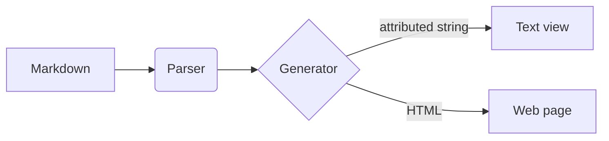

# Critical Document Title

## Summary

Lorem ipsum dolor sit amet, **consectetur adipiscing** elit.
Aliquam non risus in massa ornare lacinia. Etiam at ullamcorper
ligula. Mauris et orci ut lectus convallis euismod. _Mauris_
vitae purus congue, finibus tellus nec, lacinia felis.

Etiam eget lectus quis leo tincidunt venenatis. Duis iaculis
tristique tempor. _Maecenas vestibulum_ vehicula dui:
[objecthub.com](https://objecthub.com).

## Considering More Options

Nullam gravida `suscipit placerat`. Vivamus gravida fermentum
magna vitae condimentum. Interdum et **malesuada fames** ac ante
ipsum primis in faucibus.

1. This is the first item
2. This is the second item
3. This is the third item

Cras laoreet ~tellus dolor~, ac `suscipit augue` molestie a.
Integer efficitur odio massa, in dictum arcu dictum in.
Aliquam dapibus congue malesuada. Vestibulum dignissim
mauris ~~id ipsum volutpat~~, in dignissim nisi luctus.
Praesent scelerisque nisi non porttitor dictum. Etiam
finibus ac libero at rhoncus.

* This is the first item
* This is the second item
* This is the third item

Lorem ipsum dolor sit amet, **consectetur adipiscing** elit.
Aliquam non risus in massa ornare lacinia. Etiam at ullamcorper
ligula. Mauris et orci ut lectus convallis euismod.

1. Let's see if this works also in a list
2. And here is the diagram:

   > ```mermaid
   > sequenceDiagram
   >     autonumber
   >     actor User
   >     participant Frontend
   >     participant Database
   >     User->>Frontend: Request Data
   >     Frontend->>Database: Query Records
   >     Database-->>Frontend: Return Data
   >     Frontend-->>User: Show Results
   > ```
   >
   > This is a _Mermaid_ diagram rendered inlined.

## Left To Do

Some items are already done, others are still open:
    
- [x] Review the **summary** of the document
- [x] ~~Remove~~ the duplicate section about `options` and verify the outcome.
- [ ] Check all links, in particular [objecthub.com](https://objecthub.com)
- [ ] Ask for a second opinion

The final steps have to be completed in this order:

1. [x] Collect the feedback of the reviewers
2. [x] Merge the changes into the final text and proof-read is one more time
3. [ ] Publish the document
4. [ ] Archive the _previous_ versions

## Final Remarks

Nunc at dignissim lectus. Integer ligula velit, ullamcorper
id rutrum vel, iaculis aliquet quam. Praesent congue viverra
lorem vel faucibus.

> Cras nibh ex, lobortis a tincidunt vel, cursus a dolor.
> Proin accumsan a risus in venenatis. Etiam eleifend, nisi
> in auctor tristique, felis risus sodales nibh, eu sodales
> nunc diam ut sapien.

## Last But Not Least

Pellentesque ac lectus aliquam, efficitur lacus eu, efficitur justo.

```scheme
;; This is the first definition
(define foo 12)
; This is the second one
(define (bar n)
  (if (> n 12345)
      (foo 'end '(one two) (foo x) #t)
      "hello world"))
```

**Aenean libero nunc**, elementum at justo congue, tristique tincidunt
lorem. Donec ultrices ante mi, vehicula euismod neque egestas quis.

```swift
/// A generic stack for equatable items.
public struct Stack<T>: Equatable where T: Equatable {
  private(set) var items: [T]
  public init(items: [T] = []) {
    self.items = items
  }
  public mutating func push(item: T) { items.append(item) }
  fileprivate var description: String {
    if items.isEmpty {
      "The stack is empty"
    } else {
      "\(items.count) items in the stack"
    }
  }
}
```

Vestibulum vitae ex ut tellus auctor mattis. Aenean eget ornare
arcu. Lorem ipsum dolor sit amet, consectetur adipiscing elit.

- Morbi ut dui laoreet, euismod libero sed, tincidunt mi. Proin
  pellentesque tellus augue, vel volutpat nulla euismod sed.
    1. Sub-item 1
    2. Sub-item 2
    3. Sub-item 3

- Cras scelerisque ac turpis consequat vulputate. Quisque
  pellentesque mi a imperdiet lobortis. Nulla nec pretium dui.

- Phasellus dolor magna, feugiat et dapibus sed, sodales a eros.
  Aliquam eget sem non nisl viverra placerat sagittis eget tellus.

**Maecenas viverra**, justo nec finibus iaculis, diam turpis malesuada
nulla, et pharetra nisi diam id nisi. Nam nunc purus, condimentum
vitae risus tempor, gravida faucibus dolor. Fusce facilisis nisi
erat, et cursus justo dignissim sed.

## Advanced Features

### Tables

| Centered      | Left             | Right    |
| ------------- | :--------------- | -------: |
| This text \
  is long  | More `cell` text | One      |
| Last **line** | Last cell justo nec finibus. | Two |
| Ok one more   | And this also    | Three    |

Lorem ipsum dolor sit amet, consectetur adipiscing elit.
Aliquam non risus in massa ornare lacinia. Etiam at ullamcorper
ligula. Mauris et orci ut lectus convallis euismod.

### Mermaid Diagrams

Fenced code blocks with language `mermaid` are drawn as diagrams:



### Mathematical Formulas

Formulas are typeset with KaTeX. A formula within a line is written
between dollar signs, like $e^{i\pi} + 1 = 0$, or between the
delimiters of LaTeX, like \(a^2 + b^2 = c^2\). The solutions of
\(ax^2 + bx + c = 0\) are given by the quadratic formula:

\[
x_{1,2} = \frac{-b \pm \sqrt{b^2 - 4ac}}{2a}
\]

A formula that is a block of its own can also be written between
double dollar signs, or as a fenced code block with language `math`:

$$
\int_{-\infty}^{\infty} e^{-x^2} \, dx = \sqrt{\pi}
$$

```math
\begin{pmatrix} a & b \\ c & d \end{pmatrix}
\begin{pmatrix} x \\ y \end{pmatrix}
=
\begin{pmatrix} ax + by \\ cx + dy \end{pmatrix}
```

Formulas sit on the baseline of the text, take its color, and also
work in lists, quotes and tables:

1. The sum of the first \(n\) numbers is
   \(\sum_{k=1}^{n} k = \frac{n(n+1)}{2}\).
2. Dollar signs in ordinary text, like $5 and $6, are not formulas.

> Euler's identity \[e^{i\pi} + 1 = 0\] connects five fundamental
> constants of mathematics.

| Name   | Formula                                  |
| ------ | ---------------------------------------- |
| Circle | \(A = \pi r^2\)                         |
| Gauss  | $\sum_{k=1}^{n} k = \frac{n(n+1)}{2}$    |

***

This is the end.
